<!-- GitHub profile repo: Schrodingerrs-cat/Schrodingerrs-cat -->

  

  
  
  

<!-- These are separate clickable images; links belong in README markup, not inside SVGs. -->

Built with Python + SVG · contribution data refreshed daily using GitHub Actions · [website](https://aryanshah.work) · [LinkedIn](https://linkedin.com/in/aryan-shah-03b5b0229)
