<!-- Every card is an animated SVG drawn by scripts/render_cards.py and refreshed daily
     by .github/workflows/refresh-cards.yml. Layout: hero → heatmap → activity → link tiles.
     Spacing is baked into the SVGs, so keep this block free of blank lines and keep the
     tiles on one line with no spaces between them. -->

 
 
 

<a href="https://aryanshah.work">aryanshah.work</a> &nbsp;/&nbsp; <a href="https://linkedin.com/in/aryan-shah-03b5b0229">linkedin</a> &nbsp;/&nbsp; <a href="mailto:work.aryanshah16@gmail.com">email</a>

